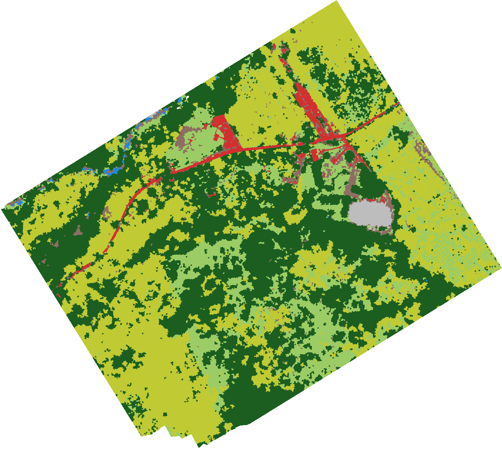

# Lite Classify

**Object-based land-cover mapping of drone orthomosaics, offline on one Windows workstation.**

Lite Classify splits an RGB orthomosaic into objects, describes each one by its color, texture,
shape, height and appearance, helps you find the classes the scene actually contains, learns
those classes from examples you click, and checks the finished map against an independent,
design-based sample.

- **User manual:** <https://leobarua.github.io/liteclassify/>
- **Download:** two offline Windows installers, linked from the manual's front page
  - **CPU** (about 320 MB): for any PC
  - **GPU** (about 1.8 GB): for PCs with an NVIDIA GPU, which run segmentation and DINOv2 faster

## How it works

You work through four tabs, left to right:

1. **Load, View & Segment:** load the orthomosaic and an optional DSM, color-correct, resample,
   and segment into objects with SLIC (CPU or GPU, tiled for large scenes). Each object gets 24
   features: color, vegetation indices, GLCM texture, shape, elevation, slope, height above
   ground, and contrast with its neighbors.
2. **Discover Classes:** each object's surroundings are described by a frozen DINOv2 ViT-S/14
   at 5 m and 10 m. The objects are over-clustered with k-means, and you review, merge, split
   and name the groups to build the class list and the first training samples.
3. **Classification:** label more samples by clicking, dragging or growing a selection, with
   help from "Find Similar Segments" and "What to Label Next". Check class separability
   (Jeffries–Matusita), train a Random Forest, retrain until the map stops improving, and export
   a GeoTIFF with a QGIS style.
4. **Accuracy Assessment:** draw a stratified or simple random sample, label the points by eye
   or import field data, and get the error matrix plus area-weighted accuracy and area estimates
   with confidence intervals (Olofsson et al., 2014; Stehman, 2014).

## Running from source

Python 3.13 on Windows 11 is the tested setup.

    python -m venv .venv
    .venv\Scripts\pip install -r requirements.txt        # PyTorch with CUDA 12.4
    .venv\Scripts\python liteclassify.py

On a machine without an NVIDIA GPU, use `requirements-cpu.txt` instead. The DINOv2 weights
(about 85 MB) are downloaded once on first use, or read from `models/` if you place them
there.

To build the executables and installers, see [`installer/README.md`](installer/README.md).

## Repository layout

| Path | Contents |
| --- | --- |
| `liteclassify.py` | Launcher: splash screen, then the main window; `--selftest` for headless checks |
| `obia_app.py` | The Qt application: the four tabs and their workflow |
| `obia_engine.py` | Raster I/O, segmentation, features, classification support, accuracy assessment (no Qt) |
| `obia_discover.py` | DINOv2 context embeddings and the Discover grouping |
| `obia_ui.py` | Reusable widgets: map viewer, toggle switch, collapsible sections, separability figure |
| `app_info.py` | Name, version and branding |
| `build_exe.py`, `installer/` | PyInstaller build and the Inno Setup installers |
| `docs/manual/` | The user manual (HTML) and the scripts that generate its figures |
| `experiments/cnn/` | The offline experiments behind the DINOv2 appearance features |
| `third_party/dinov2/` | Vendored DINOv2 backbone code (Apache 2.0) |

## License

Lite Classify is free software under the [GNU General Public License v3](LICENSE), with the
additional attribution terms in [`NOTICE.md`](NOTICE.md). Modified versions must keep the
credit line below, be marked as modified, and use a different name:

> Based on Lite Classify by L. D. Barua (LeoBar) — https://github.com/leobarua/liteclassify

For other licensing terms, see [`COMMERCIAL-LICENSING.md`](COMMERCIAL-LICENSING.md).
Contributions require agreeing to the [CLA](CLA.md).

## Citing

If you publish work made with Lite Classify, please cite it as given in
[`CITATION.cff`](CITATION.cff) (on GitHub: "Cite this repository").
